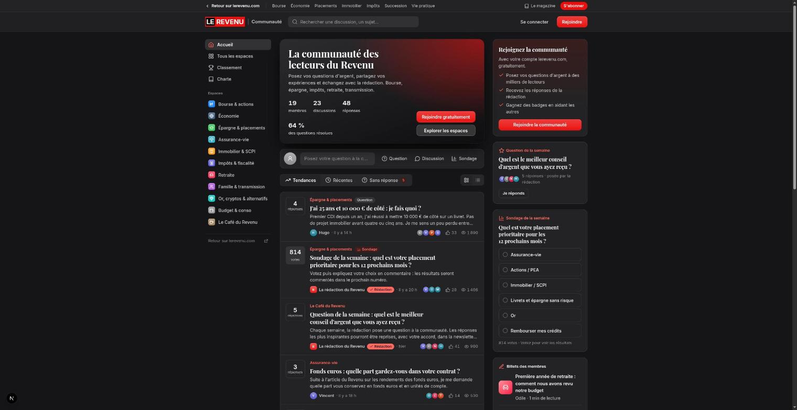
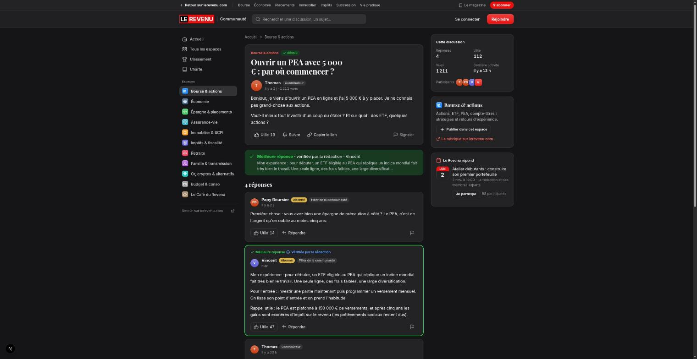
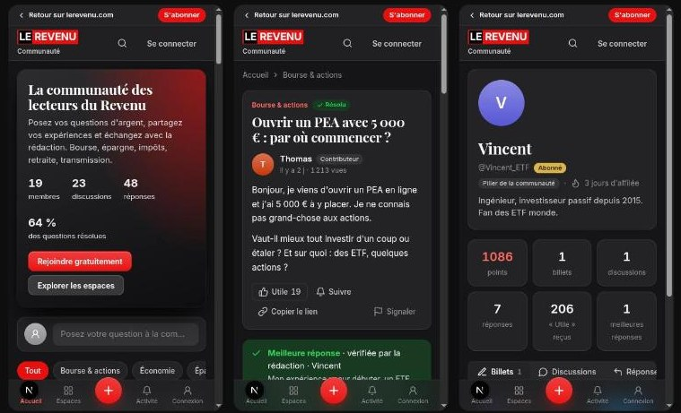

# Communauté Le Revenu

> The reader community of *Le Revenu*, a French personal-finance magazine. Readers ask money questions, share experience and talk with the newsroom. Built with **Next.js 16**, **Strapi v5** and **PostgreSQL**.

      [](https://github.com/hamzabenarfa/le-revenu-communaute/actions/workflows/ci.yml)

This is a full-stack technical test: it turns an interactive HTML prototype into a structured, maintainable application. **Every screen and use case of the prototype works against a real API.** Nothing is simulated in the browser.

<p align="center">
  
</p>

<p align="center">
  
  
</p>

## Run it (one command)

You only need **Docker** (with Compose v2). No Node, no bun, no `.env` file.

```bash
git clone https://github.com/hamzabenarfa/le-revenu-communaute.git
cd le-revenu-communaute
docker compose up --build
```

The first run takes a few minutes: it builds both images, creates the database schema, loads the demo data and builds the Next.js app. It is ready when the `web` container logs `✓ Ready`. Then open:

| What | URL | Login |
| --- | --- | --- |
| **The community** | <http://localhost:3000> | `demo@demo.fr` / `demo@demo.fr` |
| Strapi admin | <http://localhost:1337/admin> | `admin@demo.fr` / `Admin-Demo-2026` |

### Demo accounts

| Login | Password | Use it to see |
| --- | --- | --- |
| `demo@demo.fr` | `demo@demo.fr` | A fresh member |
| `camille.b@demo.lerevenu.local` | `Demo-Revenu-2026` | An active member: interests, streak, notifications |
| `thomas.pea@demo.lerevenu.local` | `Demo-Revenu-2026` | The author of a question: choose a best answer |
| `laredaction@demo.lerevenu.local` | `Demo-Revenu-2026` | The newsroom: SEO card, answer verification |

A guided 5-minute tour is in [docs/DEMO.md](docs/DEMO.md).

### Stop, reset, troubleshoot

```bash
docker compose down        # stop (data is kept)
docker compose down -v     # stop and delete all data; the next `up` re-seeds from scratch
```

- **A port is already taken** (3000, 1337 or 5433): `WEB_PORT=3001 CMS_PORT=1338 DATABASE_PORT=5434 docker compose up --build`.
- **"Impossible de charger les discussions"**: the CMS is still starting. Wait for `docker compose ps` to show `cms` as `healthy`.

The secrets in `docker-compose.yml` are public demo placeholders. Override them in a root `.env` before running the stack anywhere other than your own machine.

## Local development

To work on the code with hot reload, run PostgreSQL in Docker and the two apps on your machine (Node.js 20–26, bun 1.4):

```bash
cp .env.example .env && docker compose up -d db                       # PostgreSQL on :5433

cd apps/cms && cp .env.example .env && npm install
npm run seed && npm run develop                                        # Strapi on :1337

cd ../web && cp .env.example .env.local && bun install && bun run dev  # App on :3000 (another terminal)
```

Stop the `cms` and `web` containers first if the full stack is running (`docker compose stop cms web`). Full setup and every environment variable: [docs/INSTALL.md](docs/INSTALL.md).

## Deploy for free (demo, not production)

Strapi needs a long-running server, so it cannot run on Vercel. The free setup splits the stack over three hosts:

| Part | Host | Config |
| --- | --- | --- |
| Next.js (`apps/web`) | Vercel (Hobby) | Root Directory `apps/web` |
| Strapi (`apps/cms`) | Render (free web service, Docker) | [`render.yaml`](render.yaml) |
| PostgreSQL | Neon (free) | [`neon.ts`](neon.ts) |

**1. Neon.** Create a project (or `neon init` / `neon deploy` with the [Neon CLI](https://neon.com/docs/cli)) and copy the **direct** connection string, the one whose host has no `-pooler`. Strapi runs its schema migrations at boot and keeps its own pool, so it does not go through Neon's pooler.

**2. Render.** *New → Blueprint*, pick this repository: `render.yaml` creates the `lerevenu-cms` service and generates the Strapi secrets. Render then asks for:

| Variable | Value |
| --- | --- |
| `DATABASE_URL` | The Neon direct connection string |
| `SEED_USER_PASSWORD` | Password of the demo members (8+ chars) |
| `ADMIN_EMAIL`, `ADMIN_PASSWORD` | Strapi admin account (8+ chars, upper, lower, digit) |

Strapi creates the schema on its first start. On a new, empty database, set `SEED_ON_START=true` in the Render environment for that first deploy: it loads the demo data and creates the admin account (both idempotent). Once `https://<service>.onrender.com/_health` returns `204`, set it back to `false` for faster cold starts.

**3. Vercel.** *Add New → Project*, import this repository, set **Root Directory** to `apps/web`, and add:

| Variable | Value |
| --- | --- |
| `STRAPI_URL` | `https://<service>.onrender.com` |
| `SITE_URL` | The Vercel URL, e.g. `https://<project>.vercel.app` |

`next build` prerenders pages from live Strapi data. Open the Render URL first so the CMS is awake when Vercel builds.

**Limits of the free plans.** Render puts the CMS to sleep after 15 minutes without traffic, so the first request after a pause takes about a minute. The [Keep CMS warm](.github/workflows/keep-warm.yml) workflow pings `/_health` every 10 minutes to prevent that; a service awake all month uses about 744 of the 750 free instance hours Render grants per workspace, so disable the workflow if another free service shares them. Set the `CMS_URL` repository variable if the Render URL differs from `https://lerevenu-cms.onrender.com`. Files uploaded through Strapi are stored on Render's disk and are lost on each redeploy (the demo data lives in Neon and is kept). Free tiers change: check each host's pricing page.

**CI/CD.** [GitHub Actions](.github/workflows/ci.yml) lints, typechecks and tests both apps (the CMS against a PostgreSQL service) and builds the Docker images on every push and pull request. Vercel deploys `main` and every pull request preview; Render redeploys the CMS only once those checks pass on `main`.

## Features

- **Feed:** four tabs ("Pour vous", "Tendances", "Récentes", "Sans réponse"), ranked and paginated by the server. Thematic spaces, a detailed or compact view, search.
- **Discussions:** questions, discussions and polls. "Utile" votes, best answer, newsroom-verified answers, follow, reply-to-@member, report, related reads.
- **Publishing:** a composer that suggests similar questions as you type, @mentions with autocomplete, a trusted-links policy, and drafts that are saved automatically. Members can also write blog posts ("billets") with comments.
- **Recognition:** points, five levels and ten badges, computed from real activity, with toasts when you earn them. Monthly and all-time leaderboard.
- **Members:** profiles, hover cards, onboarding with interests, a profile photo.
- **Newsroom:** the weekly question and poll, "Le Revenu répond" live sessions with RSVP, and an editorial role that sees SEO status and verifies answers.
- **Notifications:** replies, follows, mentions, "Utile", best answers, badges and levels.

## How it is built

```text
Browser ──▶ Next.js (Server Components + Server Actions) ──REST + JWT──▶ Strapi v5 ──▶ PostgreSQL
            httpOnly session cookie, no token in JS          rules, authorization, counters, reputation, notifications
```

- **Strapi owns every rule.** It handles validation, authorization, authorship (always taken from the token), points, notifications, the link policy and rate limiting. Next.js never touches the database.
- **Permissions as code**, synced at every boot. Real PostgreSQL unique indexes, row-locked poll counts, upload type checked from the file's bytes.
- **The prototype's design system, ported as-is** (one CSS layer, same class names), so the screens match it, dark mode included.
- **Next 16 Cache Components:** a static shell, data streamed behind Suspense, nothing member-specific cached.
- **SEO driven by the editorial rule.** Strapi decides which discussions are worth indexing (best answer, newsroom or expert input, or enough "Utile"; never the Café). The same rule sets the page's `noindex` and filters `sitemap.xml`. Pages carry canonical URLs (feed tabs and pages are query variants), Open Graph and Twitter cards, a generated share image, and JSON-LD (`QAPage` for answered questions, `DiscussionForumPosting` otherwise, `BreadcrumbList`). Forms, sign-in and search are `noindex` and disallowed in `robots.txt`. Set `SITE_URL` to the public origin.

Details: [architecture and decisions](docs/ARCHITECTURE.md) · [data model](docs/DATA-MODEL.md) · [API](docs/API.md) · [security](docs/SECURITY.md) · [design](docs/DESIGN.md).

## Tests

The tests run on your machine against the Docker database (`docker compose up -d db`, then the `npm install` / `bun install` steps above):

```bash
cd apps/cms && npm test      # 156 tests: unit + integration against a real Strapi and PostgreSQL
cd apps/web && bun run test  # 38 tests: Vitest + Testing Library
```

The suites cover:
- Anonymous writes are refused, and authors cannot be spoofed.
- Server-side validation and ownership rules for "Utile", votes and the best answer.
- The link policy, notifications, rendering safety, and the composer's validation.

See [docs/TESTING.md](docs/TESTING.md).

## Repository

```text
apps/cms   Strapi v5: content types, controllers, services, policies, permissions, seed, Jest tests
apps/web   Next.js 16: routes, Server Actions, typed Strapi client, components, Vitest tests
docs/      product, domain, architecture, data model, API, security, design, testing, install, demo, roadmap
```

## Documentation

| | |
| --- | --- |
| [Product](docs/PRODUCT.md) · [Domain](docs/DOMAIN.md) | What it is for, glossary, points and badges |
| [Architecture](docs/ARCHITECTURE.md) · [Data model](docs/DATA-MODEL.md) · [API](docs/API.md) | How it works |
| [Security](docs/SECURITY.md) · [Testing](docs/TESTING.md) | What is guaranteed, and how it is proven |
| [Design](docs/DESIGN.md) | How the prototype is reproduced |
| [Install](docs/INSTALL.md) · [Demo](docs/DEMO.md) · [Roadmap](docs/ROADMAP.md) | Run it, show it, extend it |

---

*Technical test project. "Le Revenu" is the name of the publication this exercise was written for; this repository is not affiliated with it. All member data is fictional.*
